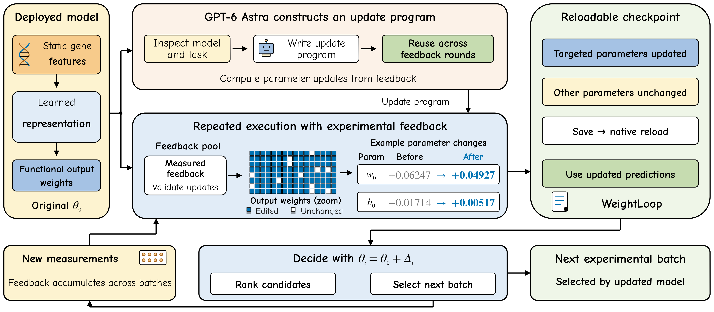
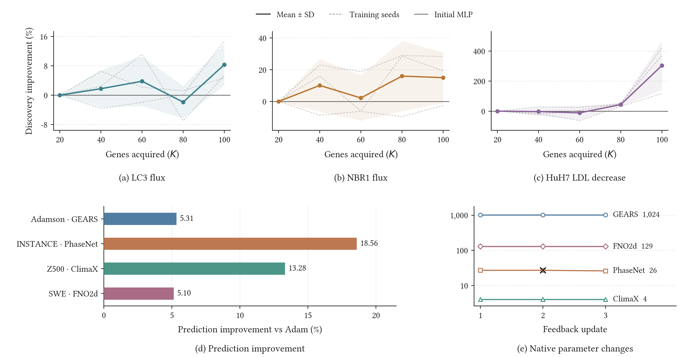

<h1 align="center">🧬 WeightLoop</h1>

<h3 align="center">Weight-Space Programming with Experimental Feedback</h3>

<p align="center">
  <b>English</b> · <a href="README.zh-CN.md">简体中文</a>
</p>

<p align="center">
  <a href="#try-it"></a>
  <a href="programs/hepg2/"></a>
  <a href="https://github.com/limengran98/WeightLoop"></a>
  <a href="assets/WeightLoop.pdf"></a>
</p>

<p align="center">
  
  
  <a href="#checks"></a>
  <a href="LICENSE"></a>
</p>

<p align="center">
  <a href="#results">🏆&nbsp;Results</a> ·
  <a href="#try-it">⚡&nbsp;Try&nbsp;it</a> ·
  <a href="#how-it-works">⚙️&nbsp;How&nbsp;it&nbsp;works</a> ·
  <a href="#checks">✅&nbsp;Checks</a> ·
  <a href="#source-data">🔬&nbsp;Source&nbsp;data</a> ·
  <a href="#repository-map">🗂️&nbsp;Code&nbsp;map</a> ·
  <a href="#citation">📚&nbsp;Citation</a>
</p>

💡 **WeightLoop turns experimental feedback into persistent model updates.** GPT-6 Astra constructs a reusable editor in an interactive coding workflow, and DeepSeek independently generates model-specific editors through its official API. Returned assays determine the numerical corrections. The resulting program estimates parameter updates from feedback, saves them in the model, and uses the reloaded predictor to choose the next experiments.

<p align="center">
  <a href="assets/figure1.png"></a>
</p>

<a id="results"></a>

## 🏆 What we achieved

| | Comparison | Primary result |
| :--- | :--- | :--- |
| 🧬 **Adamson · GEARS** | Same-feedback Adam | RNA MSE **↓5.31%** |
| 🌊 **INSTANCE · PhaseNet** | Same-feedback Adam | P-arrival MAE **↓18.56%** |
| 🌍 **ERA5 Z500 · ClimaX** | Same-feedback Adam | Geopotential RMSE **↓13.28%** · **4 output biases** changed |
| 💧 **Shallow water · FNO2d** | Same-feedback Adam | Full-field relative L2 **↓5.10%** |
| 🎯 **Functional ranking · MLP** | Feedback-updated versus initial MLP | Higher GPT-6 Astra editor mean BU in **8/8** task–budget settings |
| 🔁 **Sequential discovery · MLP** | Feedback-updated versus initial MLP ranking | Higher final mean discovery utility in **3/3** tasks for both GPT-6 Astra and DeepSeek editors |

📄 **[Author / arXiv PDF](assets/WeightLoop.pdf)** · **[Anonymous four-page submission](assets/WeightLoop_submission.pdf)**<br>
📊 **[Source tables for the displayed studies](results/)**

The four native tasks compare the fixed numerical editor with Adam using identical feedback, original checkpoints, DeepSeek-selected parameter pools and validation. The native runs use execution seed17 and reduce primary prediction error by **5.10–18.56%**. Functional ranking starts from an MLP fitted on 25 initial assays, then gives the editor 75 further feedback assays. Functional and sequential experiments report **three model-training seeds**, averaging five gene folds within each seed before computing the mean and sample SD. The [reproduction guide](docs/REPRODUCIBILITY.md) describes the data and optimizer configuration.

Code: <https://github.com/limengran98/WeightLoop> · Anonymous code: <https://anonymous.4open.science/r/WeightLoop-C75A/>.

<p align="center">
  <a href="assets/figure2.png"></a>
</p>

### 🧬 RNA output calibration

Query-set overall MSE (×10⁻³, lower is better). Values are mean ± sample SD across three model-training seeds, with three fixed partitions averaged within each seed.

| Predictor | Base | Adam | WeightLoop-A |
| :--- | ---: | ---: | ---: |
| scGPT | 11.204 ± 0.182 | **10.992 ± 0.015** | 10.997 ± 0.013 |
| scFoundation+GEARS | 12.075 ± 0.035 | 12.075 ± 0.035 | **11.171 ± 0.026** |

Base is the model adapted on 40 perturbation targets. Adam and WeightLoop-A share the same 16 feedback targets, two feedback-validation folds, writable native parameters and 20 query targets per partition. WeightLoop-A uses the GPT-6 Astra coding workflow and lowers mean overall MSE from Base by **1.85%** for scGPT and **7.49%** for scFoundation+GEARS. Adam has the lowest scGPT mean; WeightLoop-A has the lowest scFoundation+GEARS mean.

📊 [RNA protocol and source records](results/rna_calibration/) · [Summary table](results/rna_calibration/summary.tsv)

<a id="try-it"></a>

## ⚡ Try it: copy, paste, run

🖥️ **Python 3.10+ and NumPy.** The walkthrough runs on CPU, with no API key, GPU or dataset download.

```bash
git clone https://github.com/limengran98/WeightLoop.git
cd WeightLoop
python -m pip install -e '.[scientific]'
python examples/feedback_demo.py --output outputs/demo
```

✅ The example uses **75 feedback observations**, selects an update through three-fold feedback validation, saves the native parameters, and checks reload on **150 query examples**. The bundled deterministic example prints:

```text
status: updated
recipe: output_lambda0.1_radius1.0
changed_parameters: 128
native_reload_max_error: 0.0
```

📁 Outputs are saved under `outputs/demo/`. This **synthetic demonstration** uses a planted correction to show feedback fitting and native prediction replay. Later executions reuse the same update program.

<details>
<summary><strong>📦 What the walkthrough saves</strong></summary>

```text
outputs/demo/
├── original.npz      # original model parameters
├── updated.npz       # updated parameters for the same native forward
├── feedback.npz      # acquired observations and feedback folds
└── report.json       # selected recipe, metrics and reload check
```

Choose a new `--output` directory for another run to preserve previous records. The selector can return `base-kept` when feedback does not support an update.

</details>

<a id="how-it-works"></a>

## ⚙️ How it works

**GPT-6 Astra and DeepSeek construct editors. Experimental evidence determines their updates.**

1. 🧭 **Specify.** Give the scientific objective, model computation, feedback schema and editable parameter permissions.
2. 🛠️ **Construct.** Build a model-specific editor that connects observed errors to native parameter changes.
3. ✅ **Select.** Fit proposals on acquired feedback and evaluate them on separate feedback folds; the original model remains eligible.
4. 💾 **Commit.** Save the selected correction inside the model, then reload through its existing inference interface.
5. 🔁 **Repeat.** Use accumulated feedback to recompute a correction from the original checkpoint. Keep the program fixed while future experimental choices evolve.

```math
\Delta_t = \mathcal E(\theta_0,S_t),\qquad
\theta_t = \theta_0+\Delta_t,\qquad
A_{t+1}=\mathcal D(f_{\theta_t}).
```

Here θ₀ is the original parameter vector, Sₜ is the feedback accumulated at round t, and ℰ is the fixed editor that estimates correction Δₜ. The updated predictor fθₜ uses parameters θₜ; acquisition rule 𝒟 selects the next experimental batch Aₜ₊₁.

The functional predictor is an MLP with a **128-unit final hidden layer**. Native prediction tasks use **GEARS, PhaseNet, ClimaX and FNO2d**. GPT-6 Astra supplies the interactive construction workflow; the official DeepSeek API independently generates functional and sequential editors. For the four native tasks, a fixed numerical program executes within DeepSeek-selected parameter pools.

Constructor documentation: [GPT-6 Astra](https://developers.openai.com/api/docs/models/gpt-6-astra) · [DeepSeek](https://api-docs.deepseek.com/quick_start/pricing/).

📘 [Constructor responsibilities](docs/LLM_ROLE.md) · [Recorded programs](programs/hepg2/) · [Construction requests](prompts/)

<a id="checks"></a>

## ✅ Check the installation

```bash
python -m unittest discover -s tests -v
python scripts/reproduce_tables.py
```

The **18 tests** cover native inference, ReLU changes, feedback isolation, no-op selection, tied scores and model reload. The second command verifies the matched-Adam errors and percentages, feedback parity, and the three-seed functional, sequential and RNA-calibration summaries.

🔍 [Reproduction guide](docs/REPRODUCIBILITY.md) · [Project maintenance](docs/MAINTAINING.md)

<a id="source-data"></a>

## 🔬 Experiments and source data

| Study | Released records |
| :--- | :--- |
| 🎯 Same-feedback Adam comparison | [Primary errors, feedback parity and native updates](results/static_cases/) |
| 🧬 RNA output calibration | [Base, Adam and WeightLoop-A; three-seed MSE summaries](results/rna_calibration/) |
| 🧬 Functional ranking | [Initial MLP and GPT-6 Astra editing](results/additional_functional/) |
| 🔁 Sequential discovery | [GPT-6 Astra, DeepSeek and initial MLP ranking](results/additional_sequential/) |

These files support summary replay for the displayed studies. Scientific fits require the original datasets, partitions, preprocessing assets and backbones described in the [reproduction guide](docs/REPRODUCIBILITY.md).

<a id="repository-map"></a>

## 🗂️ Repository map

| Path | Contents |
| :--- | :--- |
| 🧠 [`weightloop/`](weightloop/) | NumPy native editor, feedback selection and tie-aware utility. |
| ⚡ [`examples/`](examples/) | Runnable feedback → native parameters → reload walkthrough. |
| 📝 [`programs/`](programs/) · [`prompts/`](prompts/) | Recorded generated editors and their construction tasks. |
| 📊 [`results/`](results/) | Source tables and provenance for the displayed studies. |
| 📄 [`assets/`](assets/) | Author/arXiv and anonymous submission PDFs with the same scientific content, plus figure previews. |
| 🌐 [`homepage/`](homepage/) | Responsive project website. |
| 📘 [`docs/`](docs/) | Methods, data protocols and update instructions. |
| 🧪 [`tests/`](tests/) | Numerical, feedback-isolation and reload checks. |

<a id="authors"></a>

## 👥 Authors

**Mengran Li¹ · Bo Li² · Weijing Zhao² · Chengyang Zhang³ · Boyu Zhang⁴**  
**Jinfeng Xu⁵* · Zelin Zang¹* · Victor C. M. Leung⁵ · Stan Z. Li⁶**

¹ Hong Kong Institute of Science and Innovation · ² University of Macau  
³ Sichuan University · ⁴ Sun Yat-sen University  
⁵ The University of British Columbia · ⁶ Westlake University

*Co-corresponding authors: Jinfeng Xu and Zelin Zang.*  
✉️ [limengran1998@163.com](mailto:limengran1998@163.com), [zangzelin@gmail.com](mailto:zangzelin@gmail.com)

<a id="citation"></a>

## 📚 Citation

```bibtex
@misc{li2026weightloop,
  title = {WeightLoop: Weight-Space Programming with Experimental Feedback},
  author = {Li, Mengran and Li, Bo and Zhao, Weijing and Zhang, Chengyang and
            Zhang, Boyu and Xu, Jinfeng and Zang, Zelin and Leung, Victor C. M. and Li, Stan Z.},
  year = {2026},
  howpublished = {Public author manuscript},
  url = {https://github.com/limengran98/WeightLoop}
}
```


## ⚖️ License and related work

Original software is released under the [MIT License](LICENSE). Manuscript, figure and third-party terms are described in [NOTICE](NOTICE.md) and [THIRD_PARTY_NOTICES.md](THIRD_PARTY_NOTICES.md).

Related work includes [Sparks of Weight-Space Programming](https://rikiyat.github.io/blog/weight-space-programming/) and [WeightCode](https://github.com/Gen-Verse/WeightCode), both cited in the paper.
