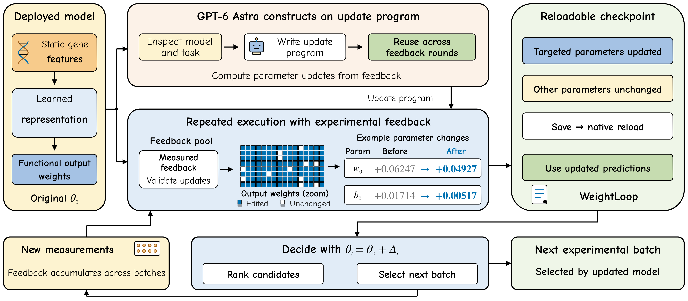
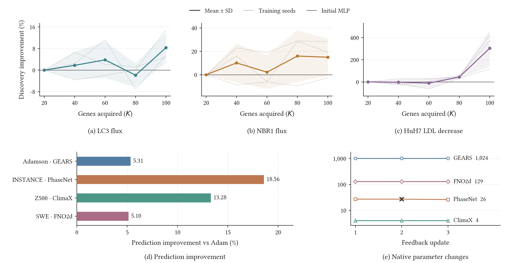

<h1 align="center">🧬 WeightLoop</h1>

<h3 align="center">融合实验反馈的权重空间编程</h3>

<p align="center">
  <a href="README.md">English</a> · <b>简体中文</b>
</p>

<p align="center">
  <a href="#try-it"></a>
  <a href="programs/hepg2/"></a>
  <a href="https://github.com/limengran98/WeightLoop"></a>
  <a href="assets/WeightLoop.pdf"></a>
</p>

<p align="center">
  
  
  <a href="#checks"></a>
  <a href="LICENSE"></a>
</p>

<p align="center">
  <a href="#results">🏆&nbsp;实验结果</a> ·
  <a href="#try-it">⚡&nbsp;立即运行</a> ·
  <a href="#how-it-works">⚙️&nbsp;工作原理</a> ·
  <a href="#checks">✅&nbsp;运行检查</a> ·
  <a href="#source-data">🔬&nbsp;结果数据</a> ·
  <a href="#repository-map">🗂️&nbsp;目录导航</a> ·
  <a href="#citation">📚&nbsp;引用</a>
</p>

💡 **WeightLoop将实验反馈转化为预测模型中持久生效的参数更新。** GPT-6 Astra通过交互式编程构建可复用编辑器，DeepSeek通过官方API独立生成模型专用编辑器；已返回的功能实验决定具体参数修正。程序固定后沿用模型的原生推理接口，支持下一批实验选择，编辑阶段无需再次调用构建模型或进行反向传播式重训。

<p align="center">
  <a href="assets/figure1.png"></a>
</p>

<a id="results"></a>

## 🏆 主要结果

| | 比较对象 | 主指标结果 |
| :--- | :--- | :--- |
| 🧬 **Adamson · GEARS** | 同反馈 Adam | RNA MSE **↓5.31%** |
| 🌊 **INSTANCE · PhaseNet** | 同反馈 Adam | P 到时 MAE **↓18.56%** |
| 🌍 **ERA5 Z500 · ClimaX** | 同反馈 Adam | 位势 RMSE **↓13.28%** · 修改 **4 个输出偏置** |
| 💧 **浅水方程 · FNO2d** | 同反馈 Adam | 全场相对 L2 **↓5.10%** |
| 🎯 **功能排序 · MLP** | 反馈更新与初始 MLP | GPT-6 Astra 编辑器在 **8/8** 个端点—预算设置中平均 BU 更高 |
| 🔁 **序贯发现 · MLP** | 反馈更新与初始 MLP 排序 | GPT-6 Astra 和 DeepSeek 编辑器在 **3/3** 个场景中最终平均发现效用更高 |

📄 **[署名版 / arXiv PDF](assets/WeightLoop.pdf)** · **[匿名四页投稿版](assets/WeightLoop_submission.pdf)**<br>
📊 **[正文所展示研究的来源表](results/)**

四个原生任务在相同反馈、原始检查点、DeepSeek 选择的参数池和验证规则下比较固定数值编辑器与 Adam，主要预测误差降低 **5.10%–18.56%**，使用执行 seed17。功能排序从使用 25 条初始实验测量训练的 MLP 出发，再为编辑器提供 75 条反馈测量。功能排序和序贯发现报告**三个模型训练 seed**，先在每个 seed 内平均五个基因折，再计算均值与样本标准差。数据与优化配置见[复现说明](docs/REPRODUCIBILITY.md)。

代码：<https://github.com/limengran98/WeightLoop> · 匿名代码：<https://anonymous.4open.science/r/WeightLoop-C75A/>。

<p align="center">
  <a href="assets/figure2.png"></a>
</p>

### 🧬 RNA 输出校准

查询集整体 MSE（×10⁻³，越低越好）。表中为三个模型训练 seed 的均值 ± 样本标准差；每个 seed 内先平均三个固定划分。

| 预测模型 | Base | Adam | WeightLoop-A |
| :--- | ---: | ---: | ---: |
| scGPT | 11.204 ± 0.182 | **10.992 ± 0.015** | 10.997 ± 0.013 |
| scFoundation+GEARS | 12.075 ± 0.035 | 12.075 ± 0.035 | **11.171 ± 0.026** |

Base 为使用 40 个扰动靶点适配的模型。Adam 与 WeightLoop-A 使用相同的 16 个反馈靶点、两折反馈验证、可写原生参数，以及每个划分中的 20 个查询靶点。WeightLoop-A 通过 GPT-6 Astra 交互式编程流程构建，将 scGPT 和 scFoundation+GEARS 的平均整体 MSE 分别较 Base 降低 **1.85%** 和 **7.49%**。scGPT 的最低均值来自 Adam，scFoundation+GEARS 的最低均值来自 WeightLoop-A。

📊 [RNA 协议与来源记录](results/rna_calibration/) · [汇总表](results/rna_calibration/summary.tsv)

<a id="try-it"></a>

## ⚡ 立即运行：复制命令即可

🖥️ 需要 **Python 3.10+和NumPy**。演示使用CPU，无需API Key、GPU或下载实验数据。

```bash
git clone https://github.com/limengran98/WeightLoop.git
cd WeightLoop
python -m pip install -e '.[scientific]'
python examples/feedback_demo.py --output outputs/demo
```

✅ 演示使用 **75个反馈样本**，经三折反馈验证选择更新，保存原生参数，并在 **150个查询样本**上检查重载。当前确定性示例输出：

```text
status: updated
recipe: output_lambda0.1_radius1.0
changed_parameters: 128
native_reload_max_error: 0.0
```

📁 文件保存至 `outputs/demo/`。这是带有预设修正信号的**合成演示**，展示反馈拟合与原生预测重放。后续执行直接复用该固定程序。

<details>
<summary><strong>📦 演示会保存哪些文件？</strong></summary>

```text
outputs/demo/
├── original.npz      # 原始模型参数
├── updated.npz       # 同一原生前向过程使用的更新参数
├── feedback.npz      # 已获得实验结果及反馈内划分
└── report.json       # 所选设置、评价和重载记录
```

再次运行时使用新的 `--output` 路径，保留已有记录。若反馈不支持更新，选择器可以返回 `base-kept`。

</details>

<a id="how-it-works"></a>

## ⚙️ 工作原理

**GPT-6 Astra 和 DeepSeek 构建编辑器，实验证据决定每次参数更新。**

1. 🧭 **定义任务。** 提供研究目标、模型计算、反馈数据格式与参数编辑权限。
2. 🛠️ **构建程序。** 将观测误差与原生模型参数修正连接起来。
3. ✅ **选择更新。** 用部分已获得反馈拟合候选修正，其余反馈验证；原模型始终保留为可选项。
4. 💾 **保存生效。** 将所选参数写入模型，通过原有推理接口重载和预测。
5. 🔁 **随证据推进。** 每次用原始参数和累计实验结果重新估计修正；程序利用这些反馈计算参数更新，再选择后续实验。

```math
\Delta_t = \mathcal E(\theta_0,S_t),\qquad
\theta_t = \theta_0+\Delta_t,\qquad
A_{t+1}=\mathcal D(f_{\theta_t}).
```

其中，θ₀ 为原始参数向量，Sₜ 为第 t 轮已积累的反馈，ℰ 为估计修正 Δₜ 的固定编辑器。更新后的预测模型 fθₜ 使用参数 θₜ，获取规则 𝒟 选择下一批实验 Aₜ₊₁。

功能预测模型是具有 **128 个单元的最后隐藏层的 MLP**；原生预测任务使用 **GEARS、PhaseNet、ClimaX 和 FNO2d**。GPT-6 Astra 用于交互式程序构建；官方 DeepSeek API 独立生成功能排序与序贯发现编辑器。四个原生任务由固定数值程序在 DeepSeek 选择的参数池内执行。

构建模型的官方资料：[GPT-6 Astra](https://developers.openai.com/api/docs/models/gpt-6-astra) · [DeepSeek](https://api-docs.deepseek.com/quick_start/pricing/)。

📘 [构建模型的具体职责](docs/LLM_ROLE.md) · [真实生成程序](programs/hepg2/) · [构建请求](prompts/)

<a id="checks"></a>

## ✅ 检查安装与结果

```bash
python -m unittest discover -s tests -v
python scripts/reproduce_tables.py
```

**18项测试**覆盖原生前向计算、ReLU变化、反馈隔离、Noop、并列分数和模型重载。第二条命令核对同反馈 Adam 的误差与降幅、反馈一致性，以及功能排序、序贯实验和 RNA 校准的三 seed 汇总。

🔍 [复现说明](docs/REPRODUCIBILITY.md) · [项目维护](docs/MAINTAINING.md)

<a id="source-data"></a>

## 🔬 实验与结果数据

| 评价 | 随库提供的记录 |
| :--- | :--- |
| 🎯 同反馈 Adam 对照 | [主误差、反馈一致性及原生更新](results/static_cases/) |
| 🧬 RNA 输出校准 | [Base、Adam 与 WeightLoop-A；三个 seed 的 MSE 汇总](results/rna_calibration/) |
| 🧬 功能排序 | [初始 MLP 与 GPT-6 Astra 编辑器](results/additional_functional/) |
| 🔁 序贯发现 | [GPT-6 Astra、DeepSeek 与初始 MLP 排序](results/additional_sequential/) |

结果表支持当前展示研究的统计复算。科学拟合还需要原始数据、固定划分、预处理文件和训练模型，详见[复现说明](docs/REPRODUCIBILITY.md)。

<a id="repository-map"></a>

## 🗂️ 目录导航

| 路径 | 内容 |
| :--- | :--- |
| 🧠 [`weightloop/`](weightloop/) | NumPy原生编辑器、反馈选择和并列分数评价。 |
| ⚡ [`examples/`](examples/) | 可运行的“反馈→参数更新→重载”演示。 |
| 📝 [`programs/`](programs/) · [`prompts/`](prompts/) | 真实生成程序与构建任务。 |
| 📊 [`results/`](results/) | 当前展示研究的来源表、seed 汇总和来源绑定。 |
| 📄 [`assets/`](assets/) | 科学内容一致的署名/arXiv版、匿名投稿版 PDF 和图件预览。 |
| 🌐 [`homepage/`](homepage/) | 响应式项目网页。 |
| 📘 [`docs/`](docs/) | 方法、数据协议和维护说明。 |
| 🧪 [`tests/`](tests/) | 数值、反馈隔离和重载检查。 |

<a id="authors"></a>

## 👥 作者

**Mengran Li¹ · Bo Li² · Weijing Zhao² · Chengyang Zhang³ · Boyu Zhang⁴**  
**Jinfeng Xu⁵* · Zelin Zang¹* · Victor C. M. Leung⁵ · Stan Z. Li⁶**

¹ Hong Kong Institute of Science and Innovation · ² University of Macau  
³ Sichuan University · ⁴ Sun Yat-sen University  
⁵ The University of British Columbia · ⁶ Westlake University

*共同通讯作者：Jinfeng Xu、Zelin Zang。*  
✉️ [limengran1998@163.com](mailto:limengran1998@163.com), [zangzelin@gmail.com](mailto:zangzelin@gmail.com)

<a id="citation"></a>

## 📚 引用

```bibtex
@misc{li2026weightloop,
  title = {WeightLoop: Weight-Space Programming with Experimental Feedback},
  author = {Li, Mengran and Li, Bo and Zhao, Weijing and Zhang, Chengyang and
            Zhang, Boyu and Xu, Jinfeng and Zang, Zelin and Leung, Victor C. M. and Li, Stan Z.},
  year = {2026},
  howpublished = {Public author manuscript},
  url = {https://github.com/limengran98/WeightLoop}
}
```

## ⚖️ 许可与相关工作

原创软件采用 [MIT许可](LICENSE)。论文、图件和第三方材料的条款见 [NOTICE](NOTICE.md) 与 [THIRD_PARTY_NOTICES.md](THIRD_PARTY_NOTICES.md)。

相关研究包括 [Sparks of Weight-Space Programming](https://rikiyat.github.io/blog/weight-space-programming/) 和 [WeightCode](https://github.com/Gen-Verse/WeightCode)，论文中均已引用。
